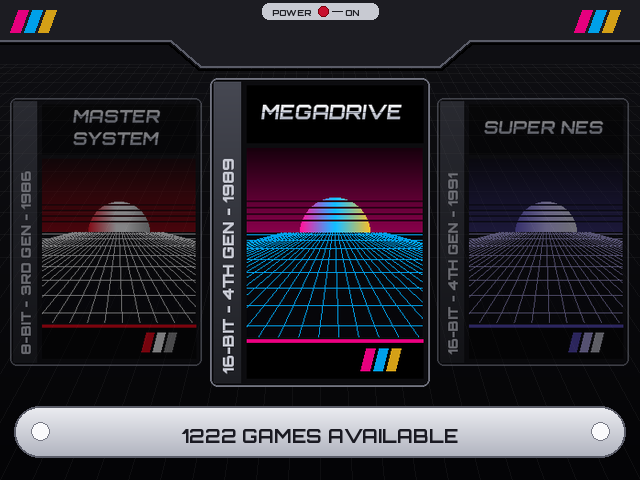
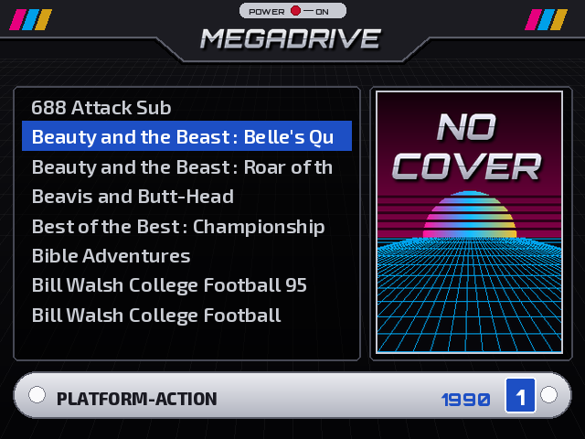
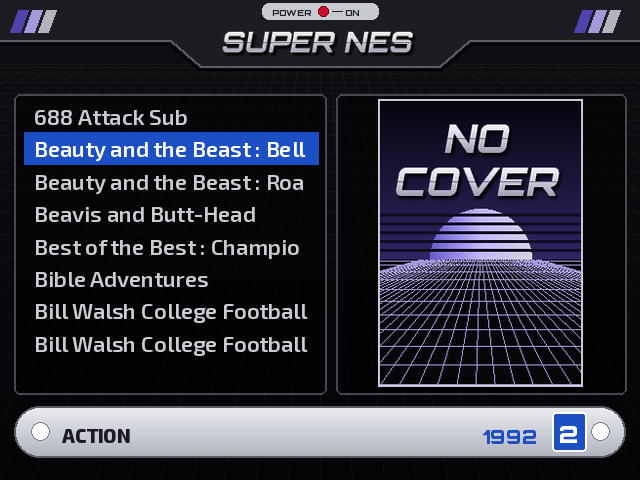

# 16-Bit-Minigen

Tema para EmulationStation feito para portáteis com tela **640x480 (4:3)**, como o **R36S / R36XX com ArkOS**.
Inspirado nos consoles mini da era 16 bits: um console preto com o **POWER ● ON** no topo, um cartucho para cada
sistema, uma lista larga e legível e só a capa do jogo.

*An EmulationStation theme for 640x480 (4:3) handhelds such as the R36S/R36XX on ArkOS: a black console, a cartridge
for every system, a wide list and the game's cover alone. English below.*

<p align="center">
  
  
  
</p>

<sub>Capturas simuladas, em 640x480, a partir da arte do próprio tema.</sub>

## O que ele tem

- **Cartuchos no carrossel**, um para cada um dos 136 sistemas do ArkOS: na lateral os bits, a geração e o ano
  (16-BIT - 4TH GEN - 1989), um pôr do sol em degradê com as três cores do console e, embaixo, as mesmas três
  faixas. Options, RetroArch, Ports, Movies e as coleções têm ícones próprios.
- **As faixas do topo mudam com o sistema**, no carrossel e na lista de jogos.
- **Lista larga e legível** (Exo 2) com a seleção em azul, e **só a capa** do jogo ao lado.
- **Capas verticais e horizontais**: SNES, Super Famicom e N64 usam um layout com a capa mais larga.
- **NO COVER** na cor do sistema quando o jogo não tem capa.
- **Barra inferior** com gênero, ano e número de jogadores.
- **Coleções** (All Games, Favorites, Last Played e as suas) com cartucho próprio.

## Instalação

1. Baixe o tema (**Code → Download ZIP**) e extraia.
2. Copie a pasta para `themes`, deixando o `theme.xml` direto dentro dela:
   - **ArkOS**: `EASYROMS/themes/16-Bit-Minigen/theme.xml`
   - **RetroBat** (para testar no PC): `RetroBat/emulationstation/.emulationstation/themes/16-Bit-Minigen/theme.xml`
3. No console: **Start → UI Settings → Theme Set → 16-Bit-Minigen**.

Dica: com o ZIP do GitHub, a pasta vem como `es-theme-16-bit-minigen-main`. Pode renomear para `16-Bit-Minigen`.

### As capas

O tema mostra a **imagem principal** (`<image>`) de cada jogo. Para ver só a capa, faça o scrape com a capa
(**Box 2D / Caixa 2D**) como imagem principal. No Skraper: frontend **RetroPie**, aba **Mídia Raspada**, só a
**Caixa 2D** em `%ROMROOTFOLDER%\media\images`, com **Manter a proporção** marcado.

## Personalizar

- **Capa horizontal ou vertical por sistema**: cada sistema tem um arquivo em `layouts/` (por exemplo,
  `layouts/snes.xml`) que inclui `portrait.xml` ou `landscape.xml`. Para mudar vários de uma vez, edite a lista
  `LANDSCAPE` em `tools/layouts.py` e rode `python3 tools/layouts.py . tools/systems.txt`.
- **O que o cartucho diz e as suas cores**: `tools/system_info.txt` tem, para cada sistema, os bits, a geração, o
  ano (o lançamento nas Américas) e as três cores (faixas, sol e topo), como `megadrive|16-BIT|4TH GEN|1989|E6007E,00A0E9,D4A017`.
  Edite e gere os cartuchos de novo.
- **Uma ilustração própria num cartucho**: coloque a imagem em `src-art/<sistema>.png` e gere os cartuchos de novo.

### Gerar a arte de novo

Precisa de Python 3 e Pillow (`pip install pillow`). Na pasta do tema:

```bash
python3 tools/gen16.py . fonts tools/systems.txt
```

```bash
python3 tools/nocover.py . tools/systems.txt
```

```bash
python3 tools/layouts.py . tools/systems.txt
```

`tools/systems.txt` traz os sistemas do ArkOS (`nome|nome completo|tema`); acrescente uma linha para um sistema novo.

## English

16-Bit-Minigen is an EmulationStation theme for 640x480 (4:3) handhelds, made for an R36S running ArkOS. Copy the folder into `themes` (`theme.xml` right inside it) and pick **16-Bit-Minigen** in **UI Settings → Theme
Set**. It shows each game's main image (`<image>`): scrape the box art (Box 2D) as the main image to see covers alone.
SNES, Super Famicom and N64 use a layout for lying covers (`layouts/`). All the art is drawn by the scripts in `tools/`.

## Licença / License

Tema e arte: [CC BY-SA 4.0](LICENSE-CC-BY-SA-4.0.txt). Fontes: SIL Open Font License 1.1. Detalhes em
[LICENSE.md](LICENSE.md). Os nomes dos sistemas são marcas dos seus donos; este tema não é afiliado a nenhum deles.
